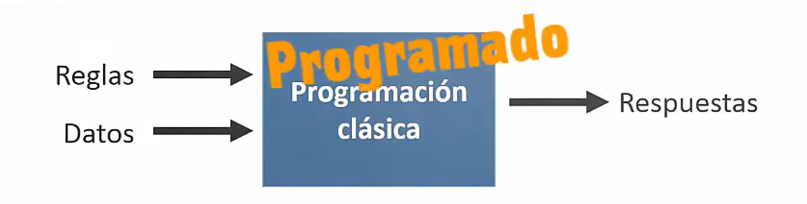
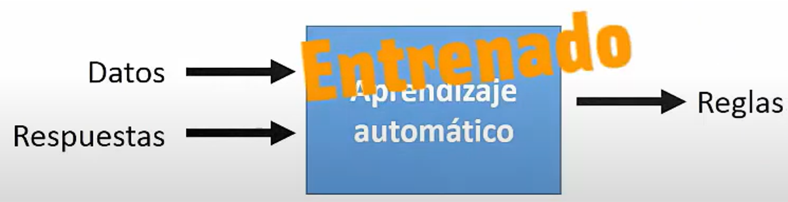
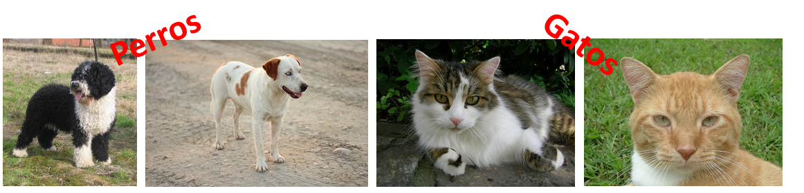
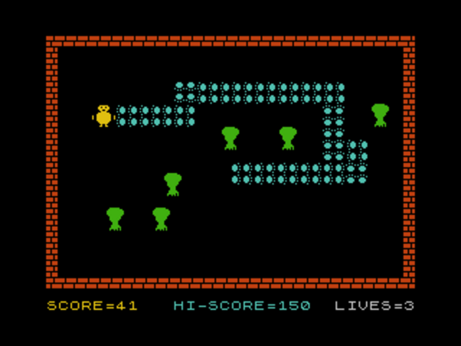
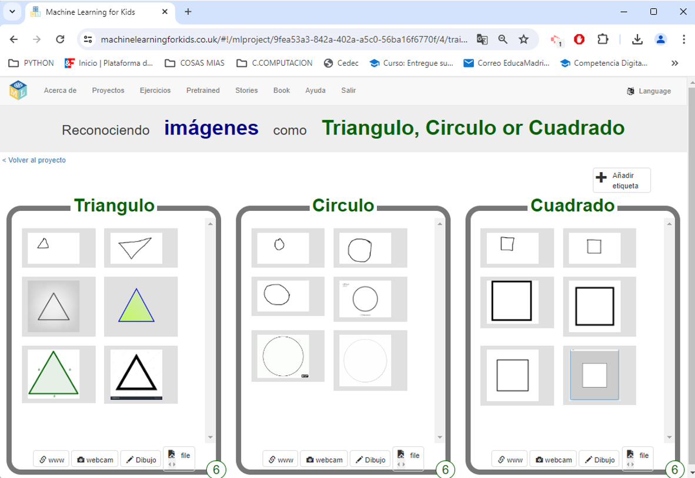
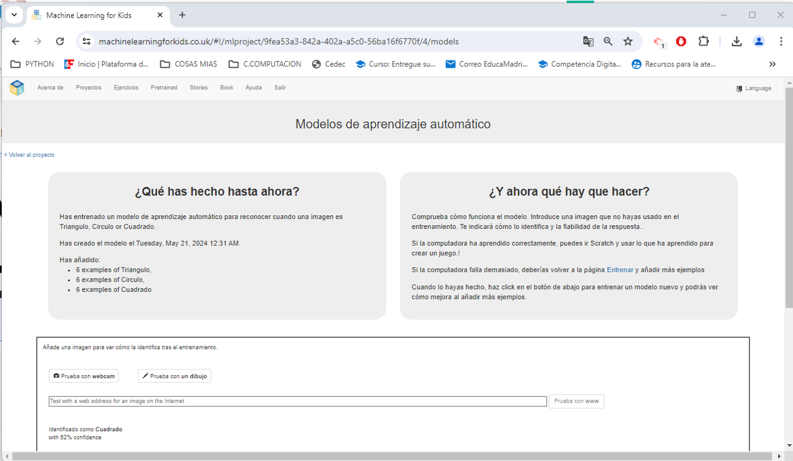
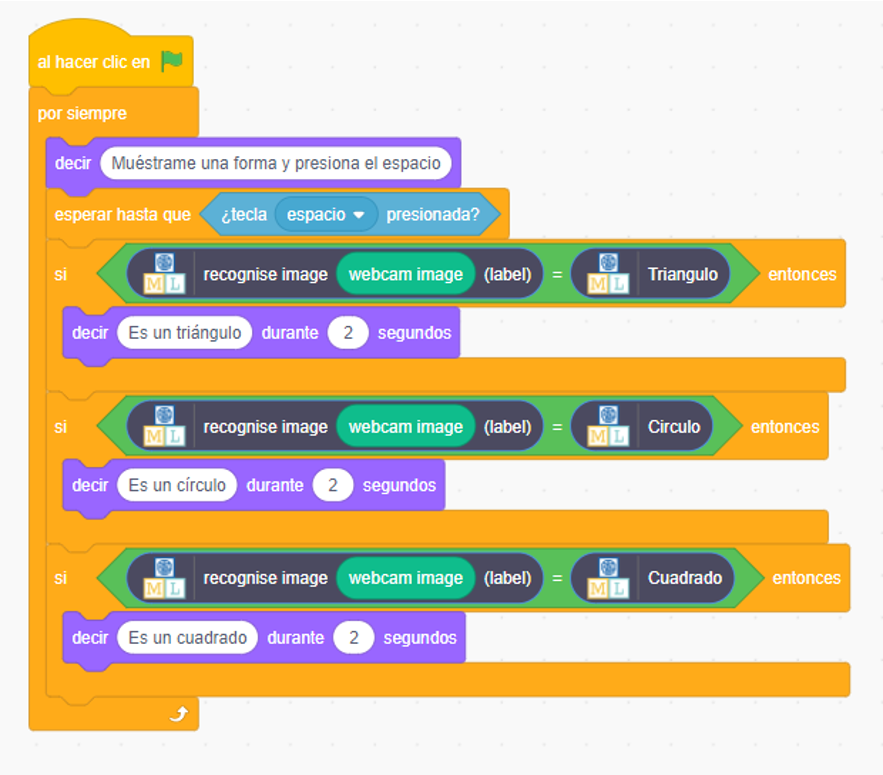

### Objetivo

Dar una visión general sobre qué es la inteligencia artificial y cómo funciona, y entrenar nuestro propio modelo de aprendizaje automático.

### Duración

2 recreos de 20 minutos.

### Materiales

-   Ordenador con cámara web.
-   Papel y lápiz.

### Actividad

#### ¿Qué es la inteligencia artificial?

La inteligencia artificial (IA) consiste en que los ordenadores realicen tareas que normalmente requieren inteligencia humana, como aprender, reconocer patrones o tomar decisiones.

#### Los pilares de la IA

El desarrollo de la IA se apoya en estos campos principales:

1.  **Aprendizaje automático (Machine Learning):** permite a los ordenadores aprender a partir de datos y mejorar con la experiencia sin ser programados explícitamente para cada caso. Ejemplo: los sistemas de recomendación de Netflix, que sugieren películas y series según tus preferencias y lo que has visto.

2.  **Procesamiento del lenguaje natural (NLP):** ayuda a los ordenadores a entender, interpretar y generar lenguaje humano. Ejemplo: los asistentes virtuales como Siri o Alexa, o los chatbots como ChatGPT o Claude.

3.  **Visión artificial:** permite a los ordenadores interpretar y entender imágenes y vídeos. Ejemplo: el reconocimiento facial que usan los móviles para desbloquearse.

4.  **Robótica:** diseño y uso de robots capaces de realizar tareas físicas. Ejemplo: los robots aspiradores, que se mueven y limpian de forma autónoma.

5.  **Sistemas expertos:** imitan la toma de decisiones de una persona experta en un área concreta. Ejemplo: herramientas de diagnóstico que ayudan a los médicos a identificar enfermedades a partir de los síntomas y datos del paciente.

Además, existe un objetivo a largo plazo que todavía no se ha alcanzado:

-   **Inteligencia artificial general (AGI):** sistemas con capacidades amplias y versátiles, parecidas a las humanas, capaces de aprender cualquier tarea intelectual y adaptarse a situaciones nuevas como lo haría una persona. Por ejemplo, un tutor que te explicara cualquier materia adaptándose a tu nivel y a tu forma de aprender.

#### ¿Qué es el aprendizaje automático (Machine Learning)?

Es una rama de la informática que desarrolla programas capaces de aprender y tomar decisiones a partir de datos, sin necesidad de programarlos específicamente para cada tarea.

Estos programas analizan grandes cantidades de datos, encuentran patrones y usan esa información para, por ejemplo, reconocer imágenes o hacer predicciones.

La gran diferencia está en **quién escribe las reglas**:

-   En la **programación clásica**, la persona programadora escribe las reglas; el ordenador las aplica a los datos y obtiene las respuestas.

{fig-align="center" fig-alt="Esquema de la programación clásica: reglas y datos producen respuestas"}

-   Con **aprendizaje automático**, le damos al ordenador los datos y las respuestas (ejemplos), y es él quien descubre las reglas.

{fig-align="center" fig-alt="Esquema del aprendizaje automático: datos y respuestas producen reglas"}

#### Tipos de aprendizaje automático

1.  **Aprendizaje supervisado:** es como aprender con un profesor. Enseñamos al ordenador con ejemplos etiquetados: por ejemplo, le mostramos fotos de perros y le decimos que son perros. Después, el ordenador es capaz de identificar perros en fotos nuevas por sí mismo.

    {fig-align="center" fig-alt="Ilustración del aprendizaje supervisado con ejemplos etiquetados"}

2.  **Aprendizaje no supervisado:** el ordenador aprende sin profesor. Le damos muchos datos sin etiquetar y él mismo busca patrones. Ejemplo: la galería de fotos del móvil agrupa automáticamente las fotos por caras, lugares o mascotas sin que le digamos de antemano a qué grupo pertenece cada una.

    {fig-align="center" width="300" fig-alt="Ilustración del aprendizaje no supervisado agrupando datos"}

3.  **Aprendizaje por refuerzo:** es como enseñar a una mascota con premios. El ordenador toma decisiones y recibe recompensas o penalizaciones según lo que haga bien o mal. Con el tiempo, aprende qué decisiones le dan más recompensas. Ejemplo: un agente virtual que aprende a jugar a un videojuego: se mueve, gana o pierde puntos y, partida tras partida, aprende a esquivar obstáculos y alcanzar sus objetivos.

    {fig-align="center" width="300" fig-alt="Ilustración del aprendizaje por refuerzo con recompensas"}

La actividad de hoy es un ejemplo de **aprendizaje supervisado**.

#### ¿Qué vamos a hacer?

Crearemos un modelo de inteligencia artificial con [Machine Learning for Kids](https://machinelearningforkids.co.uk/) que sea capaz de reconocer distintas formas (cuadrados, círculos y triángulos). Después lo usaremos en un programa de Scratch para que un personaje reconozca las formas que le enseñemos por la cámara. Las formas las dibujaremos con lápiz y papel.

#### Pasos a seguir

1.  **Recogida de datos y etiquetado:**

    -   **Datos:** la información que usamos para enseñar al ordenador. Si queremos que reconozca fotos de gatos y perros, los datos serán muchas fotos diferentes de gatos y perros.
    -   **Etiquetas:** los nombres que damos a cada dato. Cada foto de un gato llevará la etiqueta "gato" y cada foto de un perro, la etiqueta "perro".

    En nuestro caso, creamos un proyecto de tipo *reconocer imágenes* con tres etiquetas (`triangulo`, `circulo` y `cuadrado`) y añadimos fotos de nuestros dibujos con la cámara web. Cuantos más ejemplos y más variados (distintos tamaños, posiciones, grosores de trazo...), mejor aprenderá el modelo.

    {fig-align="center" fig-alt="Ejemplos de imágenes de triángulos, círculos y cuadrados etiquetados"}

2.  **Entrenamiento del modelo:** el ordenador analiza todas las imágenes y aprende las diferencias entre las formas. Un algoritmo busca patrones en las imágenes de cada etiqueta y va ajustando los parámetros del modelo para distinguirlas. Al terminar el entrenamiento, obtenemos el modelo.

    {fig-align="center" fig-alt="Entrenamiento del modelo a partir de las imágenes etiquetadas"}

3.  **Prueba del modelo:** mostramos al modelo formas nuevas que no ha visto nunca y comprobamos si las identifica bien. Si se equivoca mucho, añadimos más ejemplos y volvemos a entrenarlo.

4.  **Uso del modelo:** el modelo ya está listo para usarse en un proyecto, como un juego que reconozca tus dibujos o una aplicación que clasifique imágenes. Cada vez que le mostremos una imagen nueva, intentará adivinar si es un círculo, un cuadrado o un triángulo según lo que aprendió.

    {fig-align="center" fig-alt="Uso del modelo para clasificar una imagen nueva"}

    Nosotros usaremos el modelo desde Scratch, con los bloques que Machine Learning for Kids añade a nuestro proyecto:

    {fig-align="center" fig-alt="Programa de Scratch que usa el modelo para reconocer formas"}

::: {.callout-tip}
## ¿Quieres ir más allá?

-   Añade una cuarta forma (por ejemplo, una estrella) y vuelve a entrenar el modelo.
-   Prueba qué pasa si entrenas con pocos ejemplos o con ejemplos muy parecidos: ¿se equivoca más el modelo?
-   Haz que el personaje reaccione de forma distinta a cada forma (un sonido, un disfraz, un movimiento...).
:::
