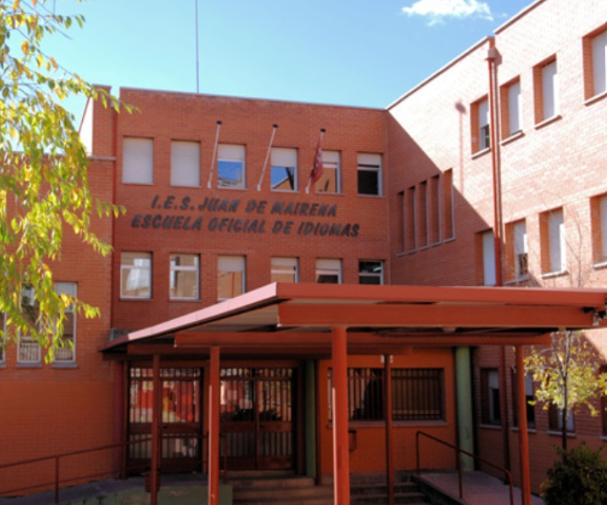

{fig-alt="Foto entrada IES Juan de Mairena"}

::: {style="text-align: center; font-size: 1.5em"}
[**¡VEN A CONOCERNOS! Estáis todos invitados.**]{.smallcaps .destacado}
:::

## Próximas actividades

> #### 📱 Recreos de los martes 21 y 28 de mayo:
>
> -   Actividad: [[¿Cómo funcionan el aprendizaje automático de la inteligencia artificial?]{.underline}]{.smallcaps}
>
> -   Organiza: Departamento de Tecnología.

::: {.callout-important}
La actividad tendrá lugar en el aula 301.
:::

## Novedades

::: {.callout-important}
## Concurso de podcast científicos STEMadrid+

El IES Juan de Mairena participa en el concurso de podcast científicos con STEMadrid+. Hemos subido nuestro podcast sobre Ada Lovelace a la plataforma Voces del Aula, compitiendo por el título al podcast más popular. Tanto estudiantes, como profesores pueden acceder con su usuario de Educamadrid para escuchar y disfrutar de nuestro trabajo.

¡La competencia está reñida y necesitamos tu ayuda! ¡Cada reproducción cuenta! En tan solo una semana finaliza el concurso, así que no pierdas tiempo.

¿Te animas a escuchar nuestro podcast y darle un like? ¡Te comparto el enlace para que te sumes a esta emocionante aventura científica con nosotros! Espero que os guste.

[Pincha aquí para acceder al préstamo y escuchar el podcast](https://stemadridplus.educa.madrid.org/info/caminantes-del-mas-alla-ada-lovelace-00201163)
:::

<!-- ::: {.callout-important style="background: white"} -->

<!-- ## Para los martes 19 de diciembre de 2023 -->

<!-- Material necesario: -->

<!-- -   Tijeras. -->

<!-- -   Pegamento o cola blanca. -->

<!-- -   Una huevera vacía, de una docena de huevos distribuidos en dos filas de seis. -->

<!-- Si no dispones de alguno de estos materiales, se administrarán en el taller. -->

<!-- ::: -->
